# AlphaLingo

A self-learning platform for Gen Alpha slang and online culture, with interactive lessons and community-reviewed content.

## About

AlphaLingo is a university group project built for SMU's CS203 Collaborative Software Development course as an SMU-X project with UBS. Learners practise cultural concepts, contributors write dictionary entries and lessons, and moderators review submissions before publication.

## The problem

Slang definitions alone can miss the context behind online language and cultural references. The project brief, "Curated Self-Learning for Gen-Alpha Culture", called for intentional learning that counters low-effort, AI-generated content, or "AI slop". AlphaLingo pairs lessons and revision with human review of contributor submissions.

## Features

| Feature | Description | User Benefit |
|:--|:--|:--|
| Interactive lessons | Units contain explanations, dialogue, and multiple-choice, matching, and text-answer questions. The API grades attempts and returns explanations. | Learn meanings in context and check understanding. |
| Personalised revision | Review questions prioritise due items and weaker past answers. Optional OpenAI hints explain the current revision question. | Revisit mistakes and get help when stuck. |
| Curated dictionary | Search approved terms, browse alphabetically, read examples, and vote on entries. | Look up unfamiliar slang and compare community feedback. |
| Community Q&A | Search questions, post Markdown questions and answers with images, vote, and mark your questions resolved. | Ask about usage that a definition does not explain. |
| Progress and rankings | Track lesson completion, XP, accuracy, and activity charts. Leaderboards rank learners by XP, correct-answer streak, or completion speed. | See progress and identify topics that need practice. |
| Contributor and moderator workflows | Create dictionary entries and lesson drafts, submit them for review, and revise rejected lessons using moderator feedback. | Keep publication accountable to human review. |

## Screenshots and user journey

### For learners

#### 1. Discover AlphaLingo

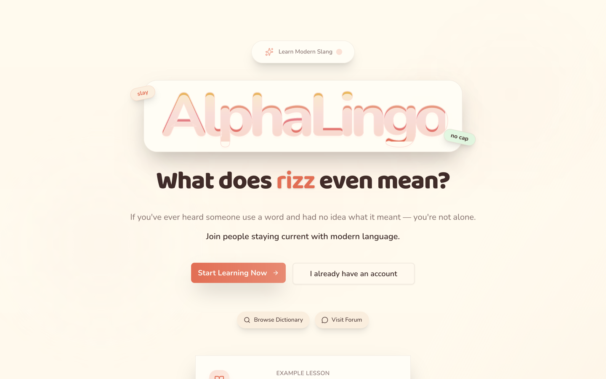

The landing page introduces the platform and links to registration, sign-in, the dictionary, and the forum.

#### 2. Sign in or create an account

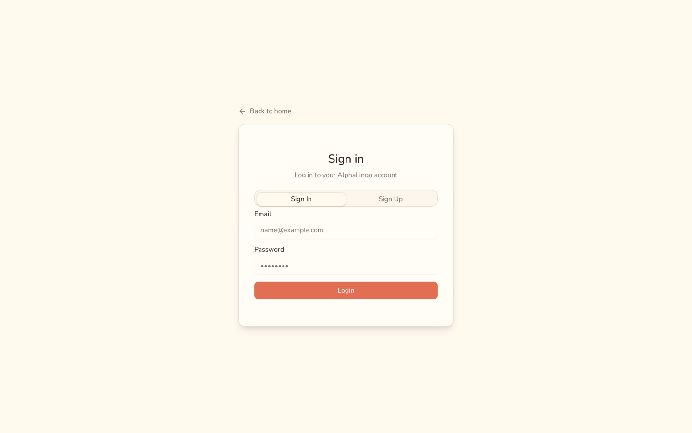

Email and password authentication uses Supabase Auth. New users can register before setting up their profile.

#### 3. Choose a lesson

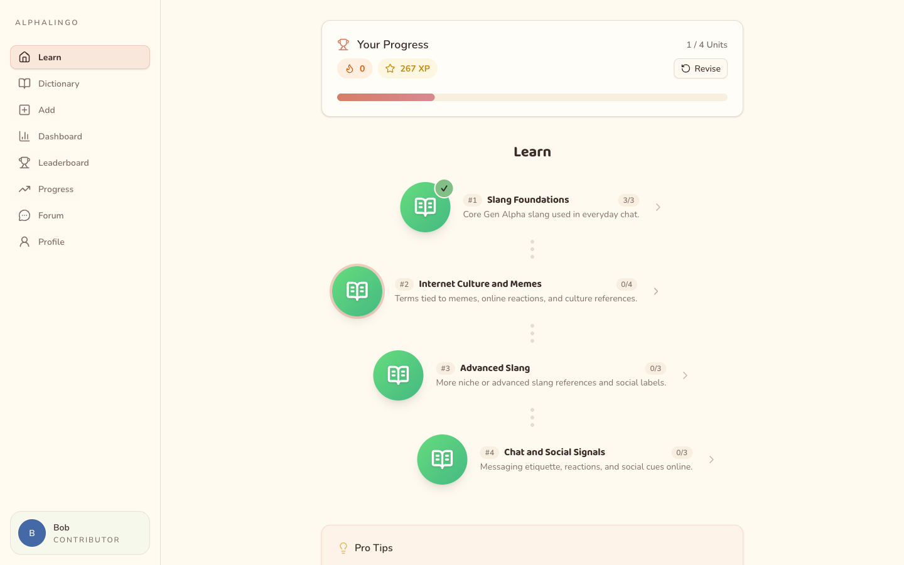

Browse the unit roadmap, see completion progress, and open a lesson.

#### 4. Practise in a lesson

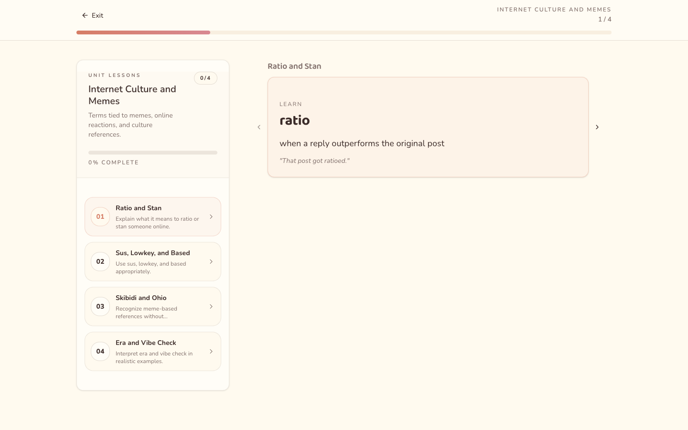

Lessons combine teaching steps with multiple-choice, matching, and text-answer questions. Submitted attempts return a score, correct answers, and explanations.

#### 5. Revise earlier questions

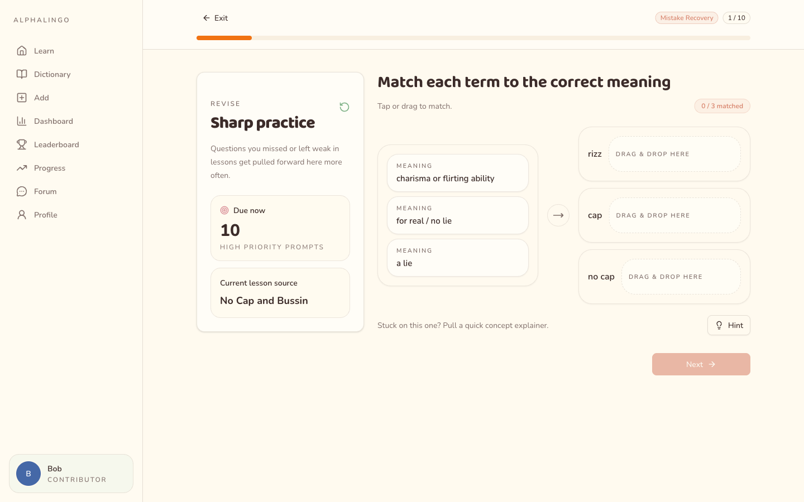

Revision draws on previous answers to prioritise due and weak questions, then fills the session with other approved lesson questions. Results separate correct answers from mistakes to revisit.

#### 6. Ask for an AI revision hint

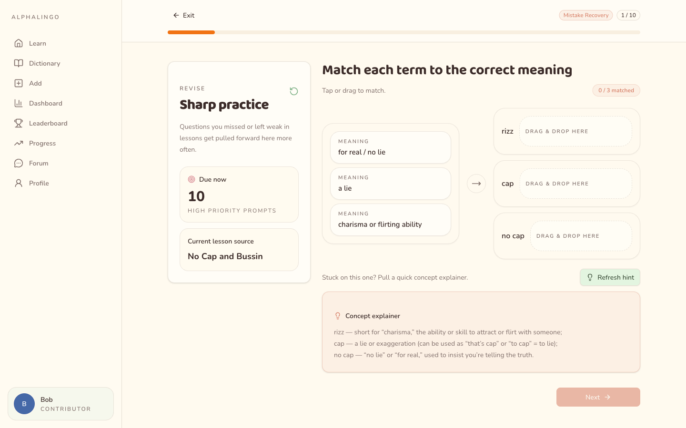

During revision, request an OpenAI-generated explanation based on the question and your current answer.

#### 7. Look up a term

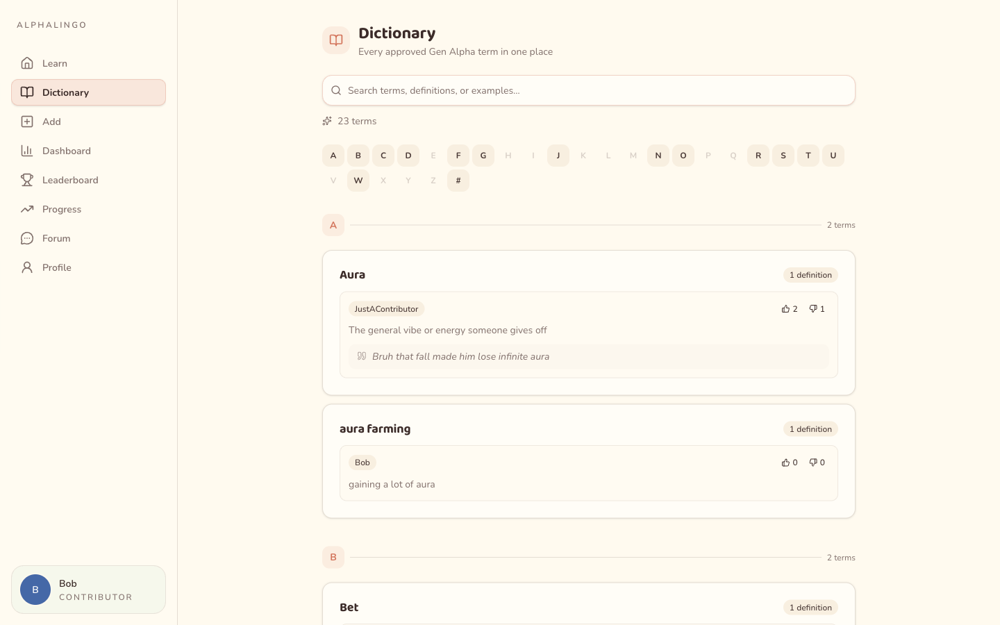

Search terms or browse alphabetically to read approved definitions and usage examples. Signed-in users can upvote or downvote entries.

#### 8. Ask the community

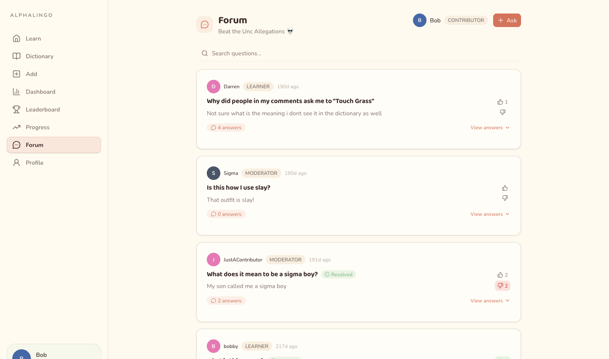

Search discussions, ask a question, or reply with Markdown and images. Users can vote on questions and answers, and question authors can mark discussions resolved.

#### 9. Compare learning progress

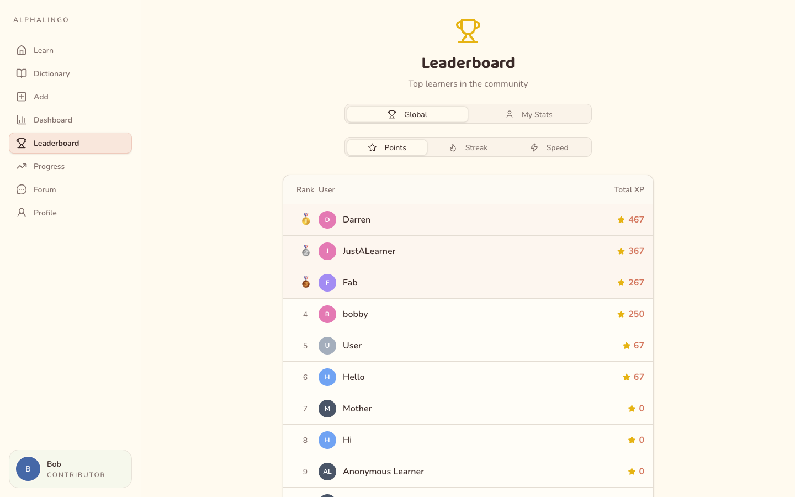

Compare learner rankings by total XP, best correct-answer streak, or average lesson completion time. The page also shows your ranks for each metric.

#### 10. Review learning analytics

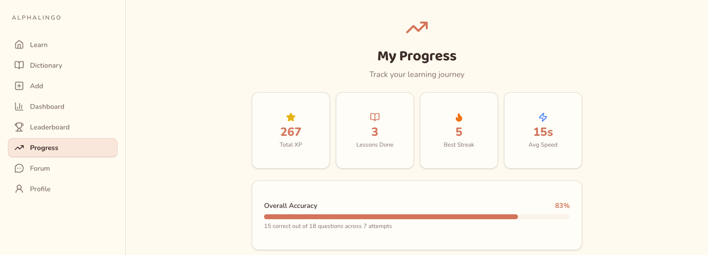

View total XP, lessons completed, best streak, average speed and overall accuracy, with daily XP, weekly attempts and unit-level accuracy charts below.

#### 11. Manage your profile

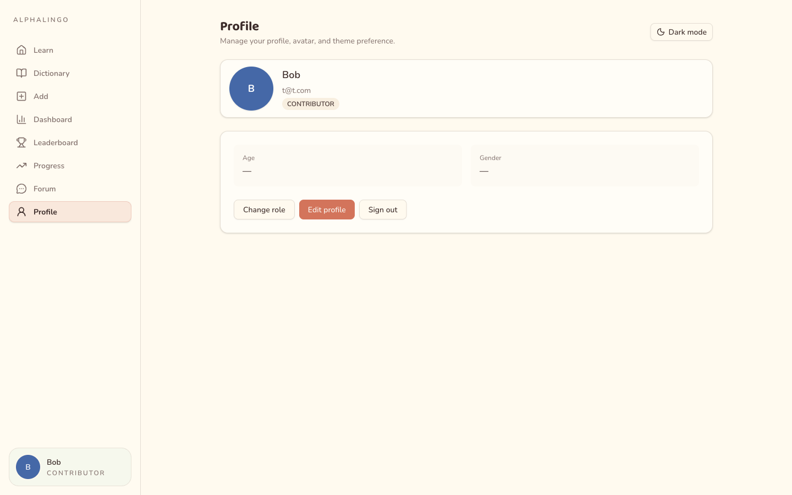

Edit your display name, bio, and avatar, choose a theme, or switch between learner and contributor roles.

### For contributors

#### 12. Track approved contributions

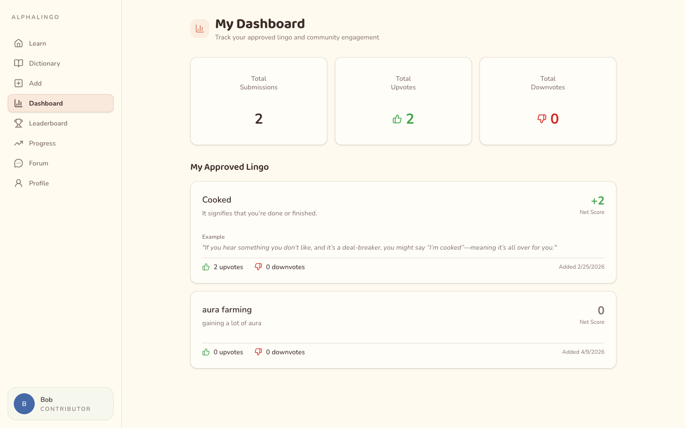

The contributor dashboard lists your approved dictionary entries and their upvotes, downvotes, and net scores.

#### 13. Author content

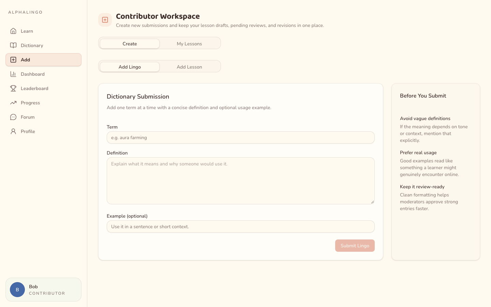

Submit a term with a definition and optional example, or build a lesson with a learning objective and teaching or quiz steps. The workspace also manages lesson drafts, pending submissions, and rejected lessons that need revision.

## Tech stack

| Area | Logo | Technologies and use |
|:--|:--:|:--|
| Frontend |  | React 19, TypeScript, Vite, and Bun; TanStack Router and Query, ky, Tailwind CSS, shadcn/ui, and Recharts. |
| Backend |  | Java 21, Spring Boot 3.5, Spring Data JPA, Spring Security, Gradle, and springdoc OpenAPI with Swagger UI. |
| Database and auth |  | Supabase PostgreSQL for application data, Supabase Auth for accounts and sessions, and Supabase Storage for avatars and forum images. |
| AI |  | OpenAI Responses API for revision hints and Moderation API for forum text and images when configured. |
| DevOps |  | Docker Compose and nginx; GitHub Actions for Gradle checks and JaCoCo reports, plus an SSH deployment workflow targeting an Azure VM. |

## Architecture

nginx serves the React SPA and proxies `/api` requests to Spring Boot. The browser signs in directly with Supabase Auth and sends its access token to the API, which verifies JWT signatures using Supabase's signing keys. Spring Data JPA stores application data in Supabase PostgreSQL, while the backend calls OpenAI for revision hints and forum moderation.

The deployment workflow runs on pushes to `main`, connects to the VM over SSH, and rebuilds the Docker Compose services. The public deployment has been torn down.

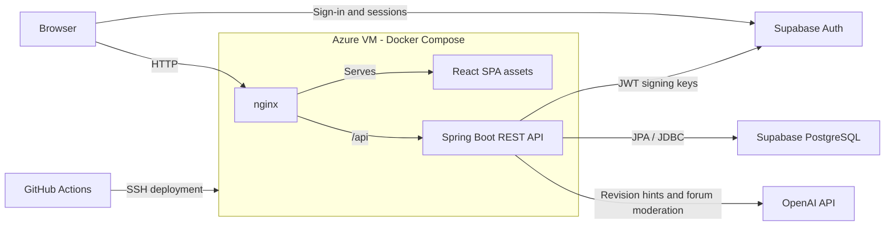

## Development

<details>
<summary>Setup and deployment instructions</summary>

## Frontend

### Requirements

- [Bun](https://bun.sh)

### Setup

```bash
cd frontend && bun install
```

### Development

```bash
# start dev server
bun run dev

# lint / format
bun run lint
bun run fmt

# preview production build
bun run preview

# build
bun run build
```

### Tech Stack

- Runtime: Bun
- SPA: Vite
- Routing: Tanstack Router
- Frontend Framework: React
- Component Library: shadcn
- Styling: Tailwind CSS
- HTTP Client: ky

## Backend

### Requirements

- [Gradle](https://docs.gradle.org/current/userguide/installation.html)
- Java 21

### Setup

```bash
cd backend && ./gradlew build
```

### Development

```bash
# start dev server
./gradlew bootRun

# run tests
./gradlew test --rerun-tasks

# format code
./gradlew spotlessApply

# build
./gradlew build

# clean build
./gradlew clean build
```

### Tech Stack

- Build Tool: Gradle (Kotlin DSL)
- Runtime: Java 21
- Framework: Spring Boot 3.5.10
- Database: Supabase (PostgreSQL)
- ORM: Spring Data JPA
- Security: Spring Security
- Validation: Jakarta Bean Validation

## Deploying

Deployment is managed with docker compose, site starts at port 80, with `/api` requests routed to backend at 8080 by nginx. Swagger UI is also proxied publicly at `/swagger-ui.html`.

### Requirements

- [Docker](https://www.docker.com/)

### Instructions

```bash
# copy frontend .env to project root
cp frontend/.env ./

# docker compose
docker compose up --build

# stop containers
docker compose down
```

</details>
